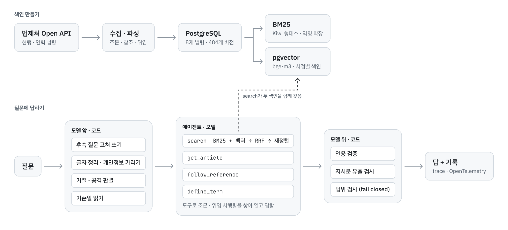
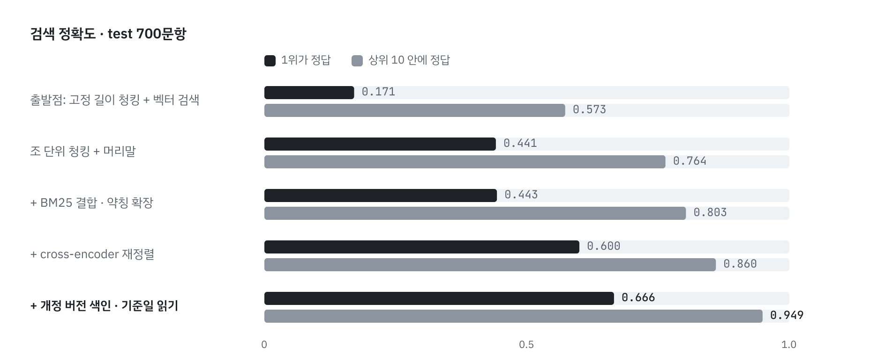

# proviso

  

한국 금융 법령을 근거로 답하는 에이전트와, 그 에이전트를 숫자로 재며 고쳐 나간 평가 하네스입니다.

전자금융거래법, 자본시장법, 금융소비자보호법, 신용정보법과 각 시행령을 제정부터 모든 개정까지 담았습니다. "2015년 당시"처럼 과거를 물으면 그날 시행 중이던 조문으로 답하고, 직접 열어 본 조문만 인용합니다.

> 법률 자문이 아닙니다. 법령은 법제처 국가법령정보센터 Open API에서 받았습니다.

## 예시

```text
$ proviso agent ask "2015년 당시 신용정보회사가 개인신용정보를 제3자에게 제공할 때 받아야 하는 동의 요건은?"

2015년 7월 1일 시행 조문 기준으로 답변드립니다.

1. 동의 대상 정보
신용정보제공·이용자가 개인신용정보를 타인에게 제공하려면 해당 개인으로부터 미리 동의를 받아야 합니다. …
[신용정보법 제32조제1항, 시행령 제28조제1항, 시행령 제2조제2항]
…
기록: proviso trace 82ee1b6a
```

질문에서 기준일을 읽어 그날 본문으로 찾고, 법 조문의 "대통령령으로 정하는"을 따라 시행령까지 열어 본 뒤 답합니다. 답에 적힌 조문은 코드가 한 번 더 확인합니다.

## 구조

<picture>
  <source media="(prefers-color-scheme: dark)" srcset="docs/images/readme-architecture-dark.png">
  
</picture>

프레임워크 없이 에이전트 루프, 검색, 평가를 직접 짰습니다. 거절 판별, 개인정보 가리기, 인용 확인처럼 코드로 확실하게 할 수 있는 일은 모델에게 맡기지 않고 모델 앞뒤에 뒀습니다.

## 결과

설정은 dev 문항으로 고르고, 숫자는 그동안 보지 않은 test 문항에서 쟀습니다.

<picture>
  <source media="(prefers-color-scheme: dark)" srcset="docs/images/readme-retrieval-dark.png">
  
</picture>

| 무엇을 쟀나 | 처음 | 지금 |
|---|---:|---:|
| 과거 시점 질문에서 그날 버전을 찾아 봄 | 0 | 0.938 |
| 후속 질문에서 정답 조문이 상위 5 안 | 0.673 | 0.982 |
| 통한 프롬프트 인젝션 (100문항) | 22 | 0 |
| 1순위 모델이 멈췄을 때 답 성공률 | 0.63 | 1.00 |
| 법령 개정 반영 시간 | 23분 | 2분 |

기본 모델인 DeepSeek V4 Flash로 질문당 약 $0.001이 들고, 인용 재현율은 0.939, 답하면 안 되는 질문은 모두 거절했습니다. 단계별 표, 모델 비교, 효과가 없었던 시도는 [결과 자세히](docs/results.md)에 있습니다.

## 빠른 시작

```bash
python3.12 -m venv .venv && .venv/bin/pip install -e ".[dev,embed]"
cp .env.example .env          # LAW_OC(법제처 Open API), OPENROUTER_API_KEY. 커밋 금지
docker compose up -d          # PostgreSQL 17 + pgvector, 포트 5433
.venv/bin/proviso db init
.venv/bin/proviso collect --all && .venv/bin/proviso load          # 법령 수집·적재
.venv/bin/proviso index build c3c1-bge-m3 && .venv/bin/proviso index build c3c1-bge-m3-all   # 색인(약 25분)
.venv/bin/proviso agent ask "온라인소액투자중개 등록하려면 자기자본이 얼마 필요한가요?"
.venv/bin/pytest
```

오픈라우터 키가 없으면 로컬 Ollama(qwen3.5:4b)로 답합니다.

| 명령 | 하는 일 |
|---|---|
| `proviso agent ask "…"` | 질문 하나에 답하고 기록을 남김 |
| `proviso agent chat` | 대화형. 후속 질문은 앞 대화를 보고 고쳐 써서 답함 |
| `proviso trace <id>` | 기록 하나를 단계별 표로 |
| `proviso serve` | 모델을 띄워 두고 HTTP로 받음(`/ask`, `/ask/stream`, `/health`, `/trace/{id}`). `pip install -e '.[serve]'` |
| `proviso eval --config …`, `proviso compare a b` | 검색 평가, 두 실행 비교 |
| `proviso agent run …`, `agent attack …`, `agent faith …`, `agent followup` | 답변 평가, 공격 평가, 근거 충실도 판정, 후속 질문 평가 |
| `proviso sync` | 바뀐 법령만 받아 적재하고 바뀐 조각만 임베딩 |
| `proviso otel` | 기록을 OpenTelemetry로 내보내기. `pip install -e '.[otel]'` |

## 개발 기록

문제 하나를 재고 고친 과정을 장마다 남겼습니다. 효과가 없었던 시도도 그대로 있습니다.

- 검색: [기준선](docs/chapters/01-baseline.md) · [조 단위 청킹](docs/chapters/02-article-chunking.md) · [키워드 검색](docs/chapters/03-keyword-search.md) · [재정렬](docs/chapters/04-reranking.md) · [임베딩](docs/chapters/12-embeddings.md)
- 답변: [근거 인용](docs/chapters/05-grounding.md) · [에이전트](docs/chapters/06-agent.md) · [과거 시점](docs/chapters/07-temporal.md) · [채점과 문맥](docs/chapters/08-scoring-context.md) · [모델 비교](docs/chapters/09-models.md) · [근거 충실도](docs/chapters/13-faithfulness.md) · [후속 질문](docs/chapters/20-followup.md)
- 안전: [거절 판별](docs/chapters/10-refusal-guard.md) · [가드레일](docs/chapters/11-guardrails.md)
- 운영: [장애 대응](docs/chapters/14-resilience.md) · [관측](docs/chapters/15-otel.md) · [서버](docs/chapters/16-serve.md) · [증분 동기화](docs/chapters/17-sync.md) · [프롬프트 캐싱](docs/chapters/18-prompt-caching.md) · [배치 API](docs/chapters/19-batch.md)
- 설계: [계획서](docs/plan.md) · [프롬프트의 층](docs/prompt-layers.md) · [그래프 스키마](docs/graph-schema.md) · [법령 연혁 분량 조사](docs/research-versioning.md) · [법적 검토 메모](docs/legal-review.md)

## 한계

- 평가 문항과 정답은 Claude가 만들었고, 사람이 본 것은 일부입니다. 무작위로 고른 30개는 모두 맞았습니다([검수 결과](evalset/README.md)).
- 핵심어로 채점해서 뜻이 뒤집힌 답도 맞다고 셀 수 있습니다.
- 재정렬 때문에 검색에 약 6초가 걸립니다.

## 라이선스

코드와 평가셋은 [MIT](LICENSE)입니다. 법령은 저작권법 제7조에 따라 보호받지 않는 저작물이고, 저장소에는 CI 점검용 조문 일부만 들어 있습니다. 전체 데이터는 `proviso collect`로 받습니다.
