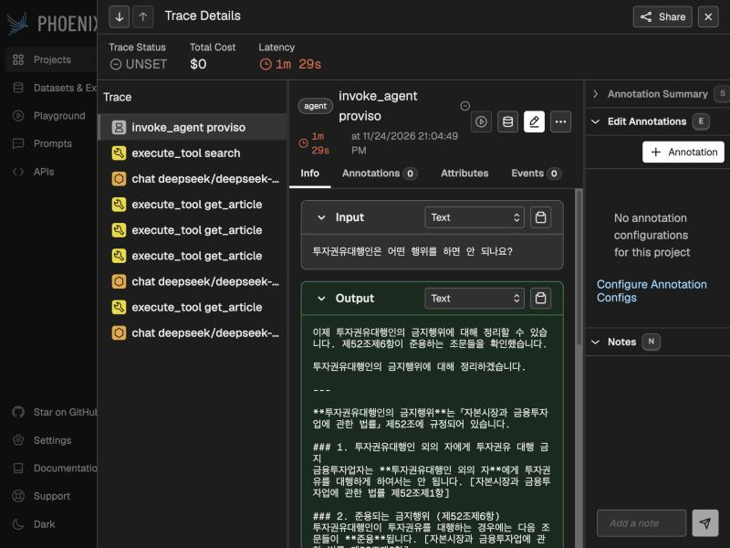
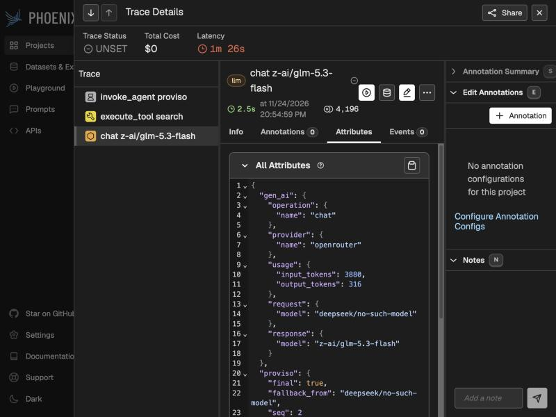
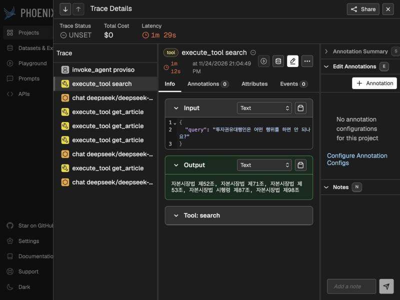

# 15장. 기록을 표준 도구로 보기: OpenTelemetry 내보내기

## 문제

6장부터 질문 하나마다 기록(trace)을 남겼다. 단계별 도구 호출, 보인 조문, 모델 호출의 토큰과 지연이 들어 있고, 14장부터는 재시도와 대체 모델 사건도 들어 있다. 그런데 이 기록은 이 프로젝트만의 형식(DB `traces`·`spans`, `runs/traces/*.jsonl`)이라 볼 수 있는 방법이 `proviso trace <id>`의 표 하나뿐이다. 실제 서비스는 이런 기록을 OpenTelemetry(OTel) 같은 표준 형식으로 내보내 Langfuse, Arize Phoenix 같은 관측 도구에서 본다. 계획서 §6의 OTel 내보내기를 이 장에서 넣는다.

## 처방

`trace/otel.py`가 기록 하나를 OTel trace 하나로 바꿔 OTLP(HTTP)로 보낸다(`proviso otel`, `pip install -e '.[otel]'`).

| 기록 | OTel span | 주요 속성 |
|---|---|---|
| 질문 하나 | `invoke_agent proviso` (부모) | `gen_ai.operation.name=invoke_agent`, `gen_ai.request.model`, 토큰 합계, 질문·답, `proviso.refused`, `proviso.as_of` |
| 모델 호출 | `chat <실제로 답한 모델>` | `gen_ai.request.model`(1순위), `gen_ai.response.model`(실제), `gen_ai.usage.input_tokens/output_tokens`, `proviso.attempts`, `proviso.fallback_from` |
| 도구 호출 | `execute_tool <도구>` | `gen_ai.tool.name`, 도구 인자, 보인 조문, 도구 오류면 span 상태 ERROR |

- 이름은 OTel 생성형 AI 규약(`gen_ai.*`)을 따랐다. Phoenix가 종류(AGENT·LLM·TOOL)를 알아보도록 OpenInference 속성(`openinference.span.kind`, `llm.token_count.*`, `input.value`·`output.value`)도 함께 단다.
- **trace id는 proviso 기록 id를 그대로 쓴다.** Phoenix 화면의 id로 `proviso trace dd932fa8`을 바로 찾을 수 있다.
- 기록에는 단계마다 걸린 시간만 있어서, 시작 시각에 걸린 시간을 차례로 더해 각 span의 시작·끝을 만든다.
- 보내는 것은 기록에 이미 있는 것뿐이다. 질문은 11장에서 개인정보를 가린 뒤의 것이고, 도구 결과 본문은 기록에 없어 보인 조문 이름만 간다.

받는 쪽은 로컬 Phoenix(docker `arizephoenix/phoenix:version-12.9.0`, 포트 6006)로 확인했다. 받는 주소만 바꾸면 Langfuse 같은 다른 OTLP 수신기로도 보낼 수 있지만, 그쪽은 확인하지 않았다.

## 화면에서 확인한 것

오늘 `proviso agent ask`로 남긴 기록 4개(span 28개)를 보냈다.



"투자권유대행인은 어떤 행위를 하면 안 되나요?": 첫 검색 → 모델 → 조문 3개 열기 → 모델 → 조문 1개 → 모델 답. `proviso trace 397dd129`의 표와 같은 순서다.



14장에서 1순위로 없는 모델 id를 준 질문이다. 모델 span에 요청한 모델(`deepseek/no-such-model`), 실제로 답한 모델(`z-ai/glm-5.3-flash`), `fallback_from`이 나온다.

### 처음 보낸 것에서 고친 것

- **단계 순서가 뒤섞였다.** 조문 열기(`get_article`)는 0.0초라 시작 시각이 같아져, Phoenix가 같은 시각의 span을 아무 순서로 놓았다. 1µs를 더해도 그대로였다(Phoenix가 ms 단위로 다루는 것으로 보인다). 단계마다 최소 1ms를 줘서 고쳤다. 원래 순서는 `proviso.seq`로도 남긴다.
- **프로젝트가 default로 들어갔다.** 리소스에 `openinference.project.name=proviso`를 넣었다.

## 관측으로 찾은 것: 첫 검색이 70~84초

Phoenix에서 기록 4개의 지연이 모두 1분 26초~1분 30초였다. span을 열어 보니 대부분 **첫 검색** 한 단계였다.



| 기록 | 전체 | 첫 검색 | 모델 호출 합 |
|---|---:|---:|---:|
| f3c3ba14 | 90.9초 | 68.0초 | 9.3초 |
| dd932fa8 | 86.2초 | 83.7초 | 2.6초 |
| ba5170b1 | 88.5초 | 73.0초 | 15.6초 |
| 397dd129 | 89.6초 | 72.4초 | 17.2초 |

평가 실행에서 같은 검색(t1-asof)은 문항당 p50 6.2~6.6초다(12장). `proviso agent ask`는 질문마다 새 프로세스라 BM25 색인, 임베딩 모델, 재정렬 모델을 매번 새로 불러온다. 그 준비 시간(약 65~75초로 어림)이 첫 검색에 들어간 것으로 보인다. 준비와 검색을 나눠 재지는 않았다.

`proviso trace`의 표에도 같은 숫자가 있었지만, 기록 여러 개를 한 화면에 놓고 보니 바로 드러났다. 고치려면 모델을 한 번만 불러 두는 서버가 필요하다(계획서 선택 7번, FastAPI 서버). 이 장에서는 고치지 않았다.

## 한계

- 내보내기는 기록이 끝난 뒤 따로 보낸다(`proviso otel`). 요청을 처리하면서 실시간으로 보내지는 않는다.
- span 시각은 걸린 시간을 이어 붙여 만든 것이라, 실제 벽시계 시각과 조금 다를 수 있다(도구와 모델 사이의 코드 실행 시간이 빠진다).
- 비용은 보내지 않는다. 기록에 단계별 요금이 없어서 Phoenix의 비용 칸은 $0이다. 질문 전체 요금은 평가 결과 파일에만 있다.
- 평가 실행(`agent run`)의 문항별 결과는 기록 형식이 달라 내보내지 않는다. `ask` 기록만 보낸다.
- Langfuse 등 다른 수신기와 OTel Collector는 확인하지 않았다.

## 다시 돌리기

```bash
pip install -e '.[otel]'
docker run -d --name proviso-phoenix -p 6006:6006 arizephoenix/phoenix:version-12.9.0
proviso agent ask "투자권유대행인은 어떤 행위를 하면 안 되나요?"
proviso otel --day 20261124                     # 그날 기록 전부 → http://localhost:6006
proviso otel 397dd129 --endpoint http://localhost:4318/v1/traces   # 다른 OTLP 수신기
```
