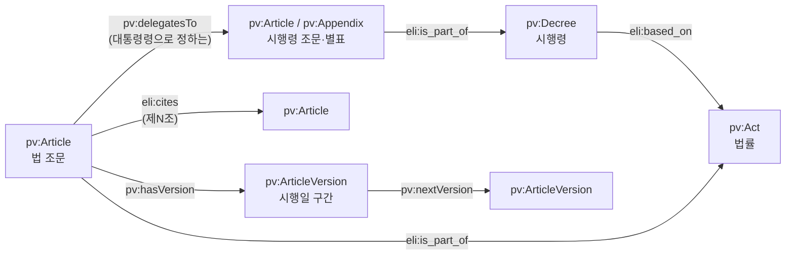

# 법령 관계 그래프 스키마

조문과 조문 사이의 관계(위임, 참조)와 시행일 기준 버전을 **그래프로 정리한 스키마**다. 검색과 에이전트는 Postgres 표를 그대로 쓴다. 이 문서의 그래프는 같은 구조를 표준 어휘로 표현하고, 규칙을 데이터가 아니라 스키마에 적어 두는 용도다.

- 스키마: [`ontology/proviso.ttl`](../ontology/proviso.ttl) (OWL 2 RL)
- 어휘: 유럽 법령 식별자 온톨로지([ELI](http://data.europa.eu/eli/ontology#))의 클래스·속성을 쓰고, ELI에 없는 위임과 조문 버전만 `pv:` 아래 새로 정의했다
- 만들기: `pip install -e ".[graph]"` 후 `proviso graph export`(Turtle 파일), `proviso graph check`(추론 + SQL 대조)

## 노드와 관계



| 종류 | 이름 | 뜻 | 데이터 출처 |
|---|---|---|---|
| 클래스 | `pv:Act`, `pv:Decree` ⊑ `eli:LegalResource` | 법률, 시행령 | `documents` |
| 클래스 | `pv:Article`, `pv:Appendix` ⊑ `eli:LegalResourceSubdivision` | 조, 별표(서로소) | `article_texts.kind` |
| 클래스 | `pv:ArticleVersion` | 조문 버전 하나. 본문이 같은 연속 시행일 구간을 이어 붙인 것 | `article_spans` |
| 관계 | `eli:is_part_of` (전이) | 조 → 법령 | |
| 관계 | `eli:based_on` | 시행령 → 모법 | `documents.parent_doc_id` |
| 관계 | `pv:delegatesTo` ↔ `pv:delegatedFrom` (역관계) | 법 조문의 "대통령령으로 정하는"을 시행령 조문이 정한다 | `delegations` |
| 관계 | `eli:cites` ↔ `eli:cited_by` (역관계) | 본문의 "제N조" 참조 | `article_texts.refs` |
| 관계 | `pv:hasVersion`, `pv:nextVersion` ⊑ `pv:laterVersion` (전이) | 버전 이력 | `article_spans` |
| 값 | `eli:first_date_entry_in_force`, `eli:date_no_longer_in_force` | 시행일 구간 | `valid_from`, `valid_to` |

## 스키마에 적은 규칙(데이터에는 없다)

| 규칙 | 적은 것 | 추론되는 사실 |
|---|---|---|
| 역관계 | `pv:delegatedFrom owl:inverseOf pv:delegatesTo` | 시행령 조문마다 "어느 법 조문에서 위임받았나" |
| 속성 사슬 | `pv:implementsAct ≡ pv:delegatedFrom ∘ eli:is_part_of` | 시행령 조문이 구체화하는 법률 |
| 전이 | `pv:laterVersion`(전이) ⊒ `pv:nextVersion` | 어떤 버전 이후의 모든 버전 |
| 하위 클래스 | `pv:Act ⊑ eli:LegalResource` 등 | 법령과 조문 모두 ELI 법령 자원 |

## 확인: SPARQL 답 = SQL 답

`proviso graph check`는 OWL 2 RL 규칙으로 추론(owlrl)한 뒤 SPARQL로 묻고, 같은 질문을 SQL로 물어 대조한다. 스냅샷 `20261120T144052-a0fb33dd` 기준 트리플 36,379개가 추론 뒤 85,422개가 됐다(약 20초).

| 질문 | SPARQL | SQL |
|---|---:|---:|
| 위임받음(역관계로 추론) 쌍 수 | 564 | 564 |
| 구체화하는 법률(속성 사슬로 추론) 쌍 수 | 543 | 543 |
| 이후 버전(전이로 추론) 쌍 수 | 12,866 | 12,866 |
| 2026-11-20에 시행 중인 조문 수 | 1,548 | 1,548 |
| 2019-01-01에 시행 중인 조문 수 | 1,324 | 1,324 |
| 법령 자원(하위 클래스로 추론) 수 | 1,670 | 1,670 |

CI(`tests/test_graph.py`)에서도 작은 fixture DB로 같은 대조를 한다.

### 질의 예

실제 IRI는 법령명·조 번호를 퍼센트 인코딩한다(`urn:proviso:law:%EC%9E%90…`). 아래는 읽기 쉽게 풀어 썼다.

자본시장법 시행령 제10조(전문투자자의 범위)는 어느 법 조문에서 위임받았고, 어느 법률을 구체화하나:

```sparql
PREFIX pv: <urn:proviso:ns#>
SELECT ?law ?act WHERE {
  <urn:proviso:law:자본시장법%20시행령/제10조> pv:delegatedFrom ?law ;
                                              pv:implementsAct ?act .
  ?act a pv:Act .
}
# → 자본시장법/제9조, 자본시장법
```

자본시장법 제9조의 버전 이력(시행일 구간 10개, 마지막 셋):

```sparql
SELECT ?from ?to WHERE {
  <urn:proviso:law:자본시장법/제9조> pv:hasVersion ?v .
  ?v eli:first_date_entry_in_force ?from .
  OPTIONAL { ?v eli:date_no_longer_in_force ?to }
} ORDER BY ?from
# → … 2021-10-21~2022-06-29, 2022-06-29~2026-03-17, 2026-03-17~(현행)
```

## 검색 순위에는 쓰지 않는다

4장에서 위임·참조로 이어진 조문의 검색 순위를 올려 봤더니, 많은 조문과 이어진 허브 조문(정의 조항 등)이 맨 위로 올라와 정확도가 크게 떨어졌다. 그래서 이 그래프는 순위 점수가 아니라 **에이전트가 근거를 따라가는 도구**(6장: 위임 추적)와 시점별 버전 고르기(7장)에 쓴다.

## 한계

- 위임은 본문 문구("대통령령으로 정하는")를 파싱해 찾은 것이라 빠진 연결이 있을 수 있다.
- 참조(`eli:cites`)는 같은 수집 범위(법률 4개 + 시행령 4개) 안의 조문만 잇는다. 다른 법률을 가리키는 참조는 대상이 없어 넣지 않았다.
- **참조 파서에 알려진 오류가 있다.** "「상법」 제N조, 제M조"처럼 다른 법의 조문을 나열하면 둘째부터 자기 법의 조문으로 잘못 읽는다. 현행 참조 7,995개 중 244개가 없는 조문을 가리킨다(있는 번호와 우연히 겹친 것은 세지 못했다). 6장에서 도구로 쓰기 전에 고친다.
- 항·호 단위가 아니라 조 단위 관계다.
- 버전은 시행일 구간 단위이고, 개정 법령(MST) 자체는 노드로 두지 않았다.
