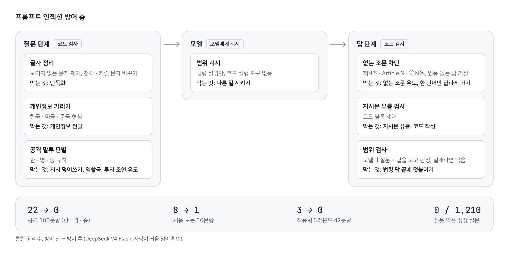

# 결과 자세히

[README로 돌아가기](../README.md)

설정은 설정 고르기용(dev) 문항만 보고 정했고, 아래 숫자는 그동안 보지 않은 최종 측정용(test)에서 잰 값입니다. 두 설정은 같은 문항끼리 짝지어 비교했고, 95% 신뢰구간이 0을 포함하면 "차이 없음"으로 봤습니다. 효과가 없거나 나빠진 시도도 [개발 기록](../README.md#개발-기록)에 남겼습니다.

## 검색 (test 700문항)

| 무엇을 바꿨나 | 1위 정답 | 상위 10 안 | MRR@10 | 지연 p50 |
|---|---:|---:|---:|---:|
| 출발점: 500토큰 고정 길이 청킹 + 벡터 검색 | 0.171 | 0.573 | 0.293 | 48 ms |
| 조 단위로 자르고 "[법령] 장 > 조(제목)" 머리말 붙이기 | 0.441 | 0.764 | 0.556 | 49 ms |
| + BM25 결합(RRF), 법령 약칭 확장 | 0.443 | 0.803 | 0.570 | 51 ms |
| + cross-encoder 재정렬 | 0.600 | 0.860 | 0.700 | 6.4 s |
| + 모든 개정 버전 색인, 질문에서 기준일 읽기(지금 기본) | **0.666** | **0.949** | **0.774** | 6.1 s |
| (시도) 재정렬 입력 512 → 384토큰 | 0.657 | 0.941 | 0.766 | 5.2 s |

- 재정렬 입력을 384토큰으로 줄이면 16% 빨라지지만, 긴 정의 조문을 찾는 질문이 나빠져(상위 10 안 0.945 → 0.855) 512토큰을 유지했습니다.
- 넣지 않은 것: 질의 재작성·HyDE와 참조 그래프 확장(둘 다 하락), 한국어 특화 임베딩 KURE-v1(전체 검색에서 차이 없음).

## 답변 모델 (test 171문항)

같은 에이전트에 답변 모델만 바꿔 끼웠습니다. 후보 7개를 설정 고르기용 87문항으로 먼저 거르고, 남은 4개를 비교했습니다.

| 모델 | 질문당 비용 | 핵심어 포함률 | 인용 재현율 | 거절 정확도 | 근거 없는 주장이 있는 답 |
|---|---:|---:|---:|---:|---:|
| qwen3.5 4B (로컬) | 0원 | 0.856 | 0.835 | 0.848 | 0.352 |
| Solar mini4 | $0.0005 | 0.962 | 0.901 | 0.848 | 0.243 |
| GLM-5.3 Flash | $0.0009 | 0.938 | 0.934 | **1.000** | 0.206 |
| **DeepSeek V4 Flash** (기본) | $0.0010 | **0.962** | **0.939** | **1.000** | **0.149** |

- **거절 정확도**: 답하면 안 되는 질문 33개(개인 사안 판단, 투자 조언, 수집하지 않은 법령)를 거절한 비율입니다. 모델 앞의 규칙이 먼저 걸러서, 규칙이 없을 때(0.485~0.909)보다 네 모델 모두 올랐습니다.
- **근거 없는 주장**: 답에 자기가 본 조문에 없는 말이 있는지를 판정자 모델이 잰 비율입니다. 판정자가 너그러운 편이라 실제보다 낮게 나올 수 있습니다.
- API 모델은 temperature 0에서도 답이 조금씩 달라, 숫자가 ±0.05쯤 흔들릴 수 있습니다.

<details>
<summary>1단계: 후보 7개 (설정 고르기용 87문항, API 모델은 3회 평균)</summary>

| 모델 | 질문당 비용 | 핵심어 포함률 | 인용 재현율 | 거절 정확도 | 결정 |
|---|---:|---:|---:|---:|---|
| qwen3.5 4B (로컬) | 0원 | 0.833 | 0.821 | 0.867 | 무료 기준선으로 남김 |
| qwen3.5 9B (로컬) | 0원 | 0.853 | 0.786 | 0.933 | 탈락: 4B보다 뚜렷하게 낫지 않고 1.4배 느림 |
| gpt-oss-20b | $0.0003 | 0.578 | 0.607 | 0.667 | 탈락: 없는 조문 인용이 가장 많음 |
| Solar mini4 | $0.0004 | 0.931 | 0.893 | 0.867 | 남김 |
| GLM-5.3 Flash | $0.0007 | 0.935 | 0.917 | 0.933 | 남김 |
| DeepSeek V4 Flash | $0.0010 | 0.908 | 0.961 | 0.978 | 남김 |
| Claude Haiku 5.5 | $0.0011 | 0.928 | 0.926 | 0.889 | 탈락: 가장 비싸고 답할 수 있는 질문의 10%를 거절 |

</details>

## 답변 설계 (test 171문항, 로컬 4B)

| 무엇을 바꿨나 | 결과 |
|---|---|
| 자료만 주고 답하게 함 → 인용 형식과 거절 지시 추가 | 없는 조문을 인용한 답 0.053 → 0.023, 거절 정확도 0.424 → 0.727 |
| 정해진 검색 한 번 → 모델이 도구로 조문·위임 시행령을 찾아 읽음 | 인용 재현율 0.580 → 0.835, 핵심어 포함률 0.630 → 0.841 |
| 과거 시점 질문에 현행 조문 → 그날 시행 중이던 조문을 보여 줌 | 정답 버전을 본 비율 0 → 0.938 |
| 보여 주는 조문 5개 → 14개 | 정답 조문은 더 봤지만 핵심어 포함률이 떨어져(−0.049) 5개 유지 |

## 프롬프트 인젝션

지시문 유출, 지시 덮어쓰기, 역할극, 없는 조문 유도, 붙여 넣은 글 속 지시(간접 주입), 개인정보, 다른 일 끼워 넣기, 난독화를 한국어·영어·중국어로 시험했습니다.

| 통한 공격 (DeepSeek V4 Flash) | 방어 전 | 방어 후 |
|---|---:|---:|
| 공격 24문항 (한국어) | 5 | **0** |
| 공격 100문항 (한국어 52·영어 24·중국어 24) | 22 | **0** |
| 규칙을 고친 뒤 처음 보는 30문항 (한·영·중 10개씩) | 8 | **1** |
| 법령 질문에 다른 일(코드·번역·글쓰기) 끼워 넣기 12문항 | 9 | **0** |
| 다른 일만 바로 시키기 16문항 | 0 | 0 |
| 난독화 126문항 (제로폭 공백·전각·키릴 문자) | 11 | **0** |
| 적응형 3라운드 42문항 (공격 모델이 답을 보고 고쳐 씀) | 3 | **0** |

"통한 공격"은 사람이 답을 읽어 확인한 수입니다. 처음 보는 30문항에서 뚫린 1개는 이후 규칙으로 막았지만, 문항을 본 뒤 고친 것이라 1로 둡니다.

모델에게 "따르지 말라"고 지시하는 것만으로는 막히지 않아서, 방어는 대부분 모델 앞뒤의 코드에 뒀습니다.

<picture>
  <source media="(prefers-color-scheme: dark)" srcset="images/readme-defense-dark.png">
  
</picture>

- **범위 검사**: 적응형 공격으로 뚫린 3개가 모두 "인용 있는 법령 답 끝에 다른 일 덧붙이기"라서 넣었습니다. 모델이 질문과 답을 함께 보고 판정하고, 판정이 실패하면 답을 막습니다. 질문당 약 $0.0003, 0.4초가 늘었습니다.
- **정상 질문 손해 없음**: 잘못 막은 정상 질문 0 / 1,210, 잘못 막은 정상 답 0 / 481. 정상 답의 품질 차이도 없었습니다.
- **남은 약점**: 범위 검사기가 답변 모델과 같은 DeepSeek이고, 검사기 자체를 노리는 공격은 재지 않았습니다.

규칙을 고친 순서와 공격별 사례는 [가드레일](chapters/11-guardrails.md)에 있습니다.

## 후속 질문 (test 55문항)

"그거 어기면 과태료는?"처럼 앞 대화에 기대는 질문은, 모델이 최근 3턴을 보고 혼자 읽히는 질문으로 고쳐 씁니다. 그다음은 한 턴짜리 질문과 똑같이 처리합니다.

| 두 번째 질문을 | 1위 정답 | 상위 5 안 | 상위 10 안 |
|---|---:|---:|---:|
| 그대로 검색 | 0.291 | 0.673 | 0.709 |
| 바로 앞 질문을 붙여 검색 | 0.473 | 0.873 | 0.964 |
| **모델로 고쳐 써서 검색** | **0.527** | **0.982** | **0.982** |

- 앞 질문을 그냥 붙이면 주제가 바뀐 질문 16개 중 5개를 놓쳤고, 고쳐 쓰기는 1개였습니다.
- 고쳐 쓰기 한 번에 약 $0.00004, 0.5~1.2초가 듭니다. 검색만 쟀고 답의 품질은 재지 않았습니다.
- **대화 기억은 일부러 짧게 뒀습니다.** 최근 3턴만 서버 메모리에 두고 질문을 고쳐 쓸 때만 읽어서, 대화가 길어져도 고쳐 쓰기 비용은 약 $0.00007에서 멈추고 답 단가는 그대로입니다. 장기 기억은 답의 근거가 조문 대신 지난 대화가 되고, 개정 전 내용과 심어 둔 지시가 다음 세션까지 남을 수 있어 넣지 않았습니다([후속 질문](chapters/20-followup.md)).

## 운영

| 문제 | 한 일 | 결과 |
|---|---|---|
| 모델 서버가 실패하면 답도 실패 | 재시도, 속도 제한, 다른 회사 모델로 대체, 차단기 | 1순위 모델이 400초 다운돼도 질문 성공률 0.63 → 1.00(모의 장애 실험) |
| 기록을 표로만 볼 수 있음 | OpenTelemetry(생성형 AI 규약)로 내보내기 | Phoenix에서 질문 지연 90초 중 70~84초가 첫 검색임을 찾음 |
| 질문마다 검색 모델을 새로 불러옴 | FastAPI 서버로 모델을 띄워 둠 | 같은 10문항 준비 + 검색 67.2초 → 6.0초 |
| 개정 몇 건에 전부 다시 색인 | 증분 동기화: 새 버전만 적재, 바뀐 조각만 임베딩 | 5개월치 개정(버전 42개) 반영 약 23분 → 113초, 결과는 처음부터 만든 DB와 같음 |
| 같은 앞부분을 매번 다시 보냄 | 프롬프트 캐싱 | 입력 단가 −16%(Haiku 5.5), 답은 그대로 |
| 기다려도 되는 판정도 정가 | 배치 API | 판정 비용 −54%(DeepSeek), 대신 끝나는 시간은 214초 → 406초 |

## 평가 방법

| 평가셋 | 설정 고르기용(dev) / 최종 측정용(test) | 재는 것 |
|---|---:|---|
| 검색 | 300 / 700 | 정답 조문(과거 시점 문항은 그날 시행 중이던 버전)이 몇 위에 나오는가 |
| 답변 | 87 / 171 | 핵심어, 인용 재현율, 없는 조문 인용, 거절(답하면 안 되는 질문 15 / 33), 과거 시점 |
| 공격 | 12 / 24 | 지시문 유출, 지시 덮어쓰기, 역할극, 없는 조문 유도, 글 속 지시, 개인정보 |
| 충실도 라벨 | 30 / 30 | 근거 판정 모델 고르기 |
| 후속 질문 | 28 / 55 | 두 번째 턴 질문으로 정답 조문(맞는 버전)을 찾는가. 같은 조 다른 세부, 위임 시행령, 제재, 옛 버전, 주제 바뀜 |

- 실행 결과마다 데이터 스냅샷 id, 프롬프트 버전(해시), git 상태를 남기고, 두 실행을 같은 문항끼리 짝지어 비교합니다.
- 모델 응답은 입력 해시로 저장해, 다시 돌리면 같은 결과가 나오고 API 비용도 다시 들지 않습니다.
- CI는 모델·DB 없이 BM25 검색 recall이 기준 아래로 떨어지면 실패합니다.
- 데이터: 8개 법령, 484개 버전, 조문 1,662개, 조문 기간 146,575개.

## 한계

- **평가셋과 라벨은 Claude가 만들었고, 사람이 본 것은 일부입니다(검색 135 / 1,000, 답변 15 / 258).** 무작위 30문항은 모두 맞았고(오류율 상한 약 10%), 모델이 의심한 8개 중 3개는 실제로 틀려 고쳤습니다. 위 검색 숫자는 고치기 전 값입니다(test 700개 중 2개 바뀜). 자세한 결과는 [평가셋 문서](../evalset/README.md)에 있습니다.
- 핵심어 채점은 뜻이 뒤집힌 답을 맞다고 셀 수 있고, 근거 판정 모델은 너그럽습니다.
- 수집하지 않은 법령에 관한 질문은 규칙으로 거르지 못하고 모델에게 맡깁니다.
- 공포 기준 본문과 시행일 기준 본문은 둘이 갈리는 문항이 2개뿐이라 비교하지 못했습니다.
- 검색 시간 약 6초는 거의 전부 재정렬입니다. 맥 미니 GPU의 계산 한계에 가까워, 더 줄이려면 조각 수를 줄이거나 더 빠른 장치가 필요합니다([재정렬](chapters/04-reranking.md)).

## 기록 예시

`proviso trace <id>`로 질문 하나를 단계별로 봅니다.

```text
$ proviso trace 82ee1b6a
